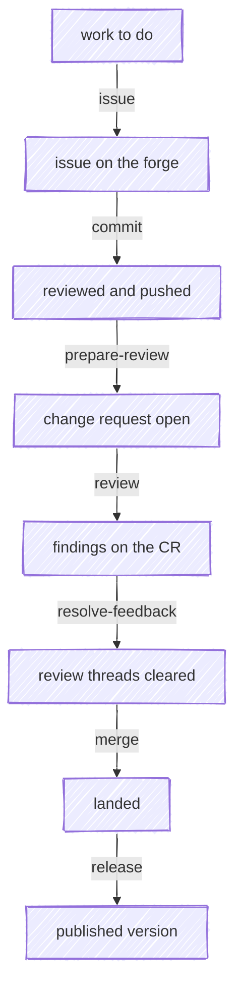

<div class="ph-hero" style="--accent: var(--color-cyan)">

<h1 class="ph-lede"><span class="ph-name">anchor</span> your development practices.</h1>

<div class="ph-badge">

[](_tags.md ':include')

</div>

</div>

An agent working for you is also speaking for you: issues, change requests,
review comments, release notes. Every one of them reaches you in full before
anyone else sees it.

Keeps your issues, commits, change requests, reviews, and releases consistent:
the same quality, structure, and formatting every time, not reinvented per
change.

## Install

```bash
claude plugin marketplace add chris-peterson/claude-marketplace
claude plugin install anchor@chris-peterson
brew install umputun/apps/revdiff   # every diff review opens in revdiff 1.14 or later
```

## Getting started

First-time setup is two decisions, and neither needs a configuration file.

**What `anchor` may reach on your forge.** It never asks you for a token and
never stores one: it shells out to your forge's own CLI, which holds the
credential in your OS keychain.

```bash
gh auth login      # GitHub remotes
glab auth login    # GitLab remotes
```

Both default to a browser sign-in, so for most people there is no personal
access token to create at all.

**How much it may do without asking.** That dial is your Claude Code permission
settings, not `anchor`. Read-only is a real place to start, and the skills still
work: `commit` reviews the diff with you and drafts the message, then stops at
the prompt for the commit itself. That prompt needs `"defaultMode": "default"`,
since a session with no mode set starts in auto. Widen it when you want to.

[**Getting started →**](/getting-started) has the token scopes, everything
`anchor` can reach with one, and how to pace both dials to your own comfort.

Then edit some code and run:

```text
/anchor:commit          # review the changeset, write the why, commit and push
/anchor:prepare-review  # rebase, draft the description, open a draft CR
```

## Tenets

### Nothing publishes under your name until you have read the exact words :id=tenet-confirm

Commit messages, CR descriptions, issue bodies, review replies, release notes:
each reaches you verbatim before it lands, in the review tool or in the reply,
never as a paraphrase and never as the output of a command you would have to
expand. Approving a plan, a shape, or a disposition is not approving the prose
that later fills it. Decline and nothing is written.

Requirements: CONFIRM-01..06 in [SPEC](/spec).

### Many edits are one review, and you decide each one :id=tenet-batch

Relabelling a set of issues, planning a release's milestones, answering every
thread on a change request: when `anchor` drafts edits to several things at
once, they open together in revdiff, one file per item with its current text
against the proposed one. Keep, edit, redraft, or drop each item where it sits,
then approve the set. Several drafts in a reply scroll the first ones away before
the question arrives; one per prompt turns reading into a chore of approving.
See [Batch Editing](/guides/batch-editing).

Requirements: CONFIRM-10..16 in [SPEC](/spec).

### A review that did not happen is not an approval :id=tenet-review

A viewer that opened and reported no verdict, an editor closed without saving, a
diff tool that is not installed: each ends the step, and `anchor` walks a
[fallback](/guides/review-fallback) instead of asking *"you saw the diff,
approve?"*. That question converts a tooling failure into your sign-off.

Requirements: DIFF-12 and DIFF-20 in [SPEC](/spec).

### Anything anchor replaces can be put back :id=tenet-backup

Before `anchor` overwrites text on the forge, it saves what was there to
`.git/anchor/backups/` in your checkout, quietly, and keeps it there. A write
that lands on the wrong change request, or one you change your mind about, is
a paste away from undone, whatever edit history the forge keeps: ask the agent
to restore it, or [do it yourself](/guides/backups).

Requirement: FORGE-13 in [SPEC](/spec).

### Feedback sits beside the code it is about :id=tenet-in-place

A finding, an answer to your question, or a note on a change goes on the line it
concerns: the line that changed, or the line you asked on. You read it where you
were already reading, the way you would in any code review, instead of leaving
the diff to find what a note means.

Requirement: UX-09 in [SPEC](/spec); [reading a diff](/guides/reading-a-diff).

### An explanation lasts as long as it stays true :id=tenet-transient

| What it explains | Lasts | Goes in |
| --- | --- | --- |
| why the code is this way | the code's lifetime | a comment, rarely |
| why this change exists | the history | the commit message, the CR description |
| why this line is this way, what was weighed, what to check | this review | a note on the line, gone when the review closes |

When `anchor` shows you a change it wrote, the reasoning you need to judge it
arrives as notes on the lines it concerns, and leaves with the review. The
commit message, the CR description, and the code keep only what stays true, so
they stay short, and nothing in the permanent record narrates a decision to a
reader who wasn't there for it.

Requirement: UX-12 in [SPEC](/spec); [notes on your own changes](/guides/review-notes).

### No AI attribution :id=tenet-attribution

No `Co-Authored-By` trailer, no *Generated with* footer. The commit author and
CR author fields already record who ran it.

Requirement: RULE-02 in [SPEC](/spec).

## Skills

| Skill | What it does |
|---|---|
| [`/anchor:commit`](/skills/commit) | Review the changeset, then commit with a why-first message and push |
| [`/anchor:amend`](/skills/amend) | Fold the staged changes into the last commit, with the same tests and review as a commit |
| [`/anchor:prepare-review`](/skills/prepare-review) | Rebase on its base branch (stacked on another CR, where it is) and open a draft change request |
| [`/anchor:rebase`](/skills/rebase) | Catch a branch, or its whole stack, up to the branch it merges into, resolve the conflicts, and force-push |
| [`/anchor:stack`](/skills/stack) | Show a stack of CRs as a tree, start the next branch on top, move a branch onto another CR, review it bottom up |
| [`/anchor:review`](/skills/review) | Weigh a CR against your qualities, draft a fix per finding, and decide each one in revdiff before reviewing the whole change |
| [`/anchor:ready`](/skills/ready) | Take a draft CR out of draft, request reviewers, and report its pipeline |
| [`/anchor:resolve-feedback`](/skills/resolve-feedback) | Work a CR's review threads to done, one by one |
| [`/anchor:merge`](/skills/merge) | Check the merge gates, wait on the pipeline, then land the CR and clean up |
| [`/anchor:release`](/skills/release) | Work out what's shipping, recommend a version, draft the notes, publish |
| [`/anchor:backlog`](/skills/backlog) | Rank the forge issues assigned to you so you can pick what to work on next |
| [`/anchor:issue`](/skills/issue) | File a new forge issue that leads with why the work is needed |
| [`/anchor:pipeline`](/skills/pipeline) | Report a commit's forge pipeline state, or watch until it settles |

Standing guidance the plugin injects on its own, and the wiring behind it:
[ambient rules](/ambient-rules), [hooks](/hooks), [events](/events).

## The lifecycle

Which skill carries a change from one state to the next:



## In action

Tests pass, and `/anchor:commit` does the rest: staging, a why-first message,
and a code review that turns a rejected change into a concrete edit:

<div class="cw-session" data-cw-session="session"></div>

What they look like in a real session:

<div class="cw-session" data-cw-session="examples"></div>

## Why these skills

The diff already shows *what* changed. The expensive, easily-skipped parts are
the ones a diff can't carry: a commit message that explains *why*, a code review
before the change leaves your machine, and a CR description that points a
reviewer at the lines where their attention pays off. `anchor` makes those the
path of least resistance.

- **commit** reviews the pending changeset before it commits, and turns a
  rejected change into a concrete edit. Nothing is committed until the review
  is clean.
- **prepare-review** writes for a reviewer who has never seen the system, leads
  with the *why*, and deep-links the critical path so a skim lands on what
  matters.

## Integrations

- **[revdiff](https://revdiff.com)**: required. Every diff review opens in it,
  whatever `anchor.diff.tool` or git's own `diff.tool` names; both keys are
  ignored in 2.0. It is a terminal-native diff reviewer (git, hg, and jj) whose
  `(context).md`, preloaded notes, and Review box carry the verdict, and it marks
  which diff side each annotation sits on. Without revdiff 1.14 or later, a diff
  review stops before it opens and names the install. It renders in a terminal,
  so `anchor` opens it in one it hosts itself: a tmux popup, or an iTerm2 split
  of the session you are in. With [helix](https://github.com/helix-editor/helix)
  for drafts, it is the
  [recommended setup](/guides/configuring?id=recommended-setup).

Integration runs the other way too, and needs nothing configured. `anchor`
[announces](/events) each lifecycle fact it causes (an issue filed, a commit
pushed, a change request opened, marked ready, or merged, a release published)
as one line on its own stdout. A plugin that tracks work can follow a change from
filed to shipped by reading those, and a session where nothing is listening pays
nothing for it.

## Reference

- [Configuring `anchor`](/guides/configuring): every knob, once you want one
- [Ambient rules](/ambient-rules): the invariants the SessionStart hook injects
  when no skill is invoked, in the form the agent receives them
- **Skills**: per-skill pages in the sidebar, sourced directly from each
  `SKILL.md`
- [Guides](/guides): the standing judgment the skills apply while they work:
  the prose guides that set the voice of every message, what a review does when
  the tool returns no verdict, and the forge, release, and configuration
  mechanics underneath
- **Templates**: the output shapes the skills produce:
  [commit message](/templates/commit-message),
  [CR description](/templates/cr-description),
  [review qualities](/templates/review-qualities), and
  [issue description](/templates/issue-description)
