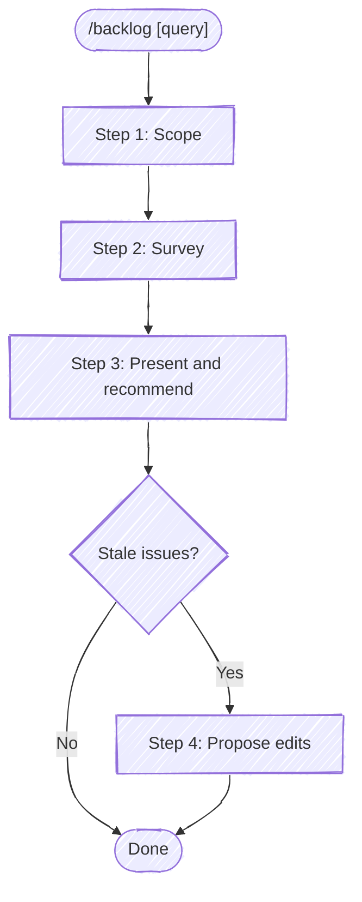

# Backlog

Survey what is filed and what is already in flight, and point at the next thing to do. "What's next?" is rarely "which issue to start": a CR waiting on your review, or a reviewed draft waiting to be marked ready, is usually the cheapest step toward shipping something. `scripts/backlog.sh` gathers the facts and ranks them. This skill reads the scope from the query, presents what the script found, and proposes edits for stale issues. It writes nothing to the forge.

**Don't narrate your work** (`${CLAUDE_PLUGIN_ROOT}/guides/execute-quietly.md`). Surface a question you need answered, the survey, and the next step.



## Step 1: Scope

Map the query to the script's flags. With no query, or a bare "what's next?", pass none: the default (assigned to me, open) is the point, so never add a filter the user didn't ask for.

| The user says… | Flags |
|----------------|-------|
| "everything open", "the whole backlog" | `--assignee any` |
| "unassigned…", "up for grabs" | `--assignee none` |
| "assigned to <person>" | `--assignee <login>` |
| "…bugs", "…labeled X" | `--label X` (repeatable) |
| "closed too", "including done" | `--state all` |
| "untouched for a month" | `--stale-days <n>` (default 60) |

If the user names another repo, resolve it with `bash "${CLAUDE_PLUGIN_ROOT}/scripts/resolve-target.sh" <name>`. On `resolved`, pass `--repo <TARGET_LOCAL>` when it's set, else `--project <TARGET_PROJECT>` (GitHub) or `--project <TARGET_URL>` (GitLab). On `ambiguous`, ask with `AskUserQuestion` from `TARGET_CANDIDATES`. On `cwd`, say the name didn't resolve rather than quietly surveying the cwd repo.

## Step 2: Survey

```bash
bash "${CLAUDE_PLUGIN_ROOT}/scripts/backlog.sh" [flags] [--repo <path> | --project <repo>]
```

Its header documents every key. `ISSUE=` lines arrive ranked, `CR=` lines arrive with those waiting on you first, and `NEXT=` is the recommended step. Take the order, the links, and `NEXT` as given rather than re-deriving them. If a link looks wrong, say so in a note under the table. On `BACKLOG_AUTH=1`, ask the user to refresh their credentials: an auth failure is not an empty backlog.

## Step 3: Present and recommend

Open with one line naming the scope (`Assigned to you · open`).

**In flight**, when there are `CR=` lines, gets one row per CR: the CR linked to its URL with its title, draft or ready, its `/anchor:review` state, its issues, and what it waits on, in words: *run `/anchor:review`*, *mark ready*, or *waiting on reviewers*, *on the author*, *on merge*.

**Issues** gets the ranked table: **#**, **Title**, **In flight** (the CR and what it needs, the branch, or `—`), **Due**, **Updated** (relative). Add **Labels** only where any are set.

Then the next step, from `NEXT`, with its one-line reason:

| `NEXT` | Say |
|--------|-----|
| `review <cr> own:none` | `/anchor:review <cr>`: yours, and never reviewed |
| `review <cr> own:partial` | `/anchor:review <cr>`: yours, pushed to since its last review |
| `review <cr> theirs:…` | `/anchor:review <cr>`: a teammate's ready CR you haven't reviewed |
| `ready <cr> own` | `/anchor:ready <cr>`: reviewed and still a draft |
| `branch <#n> <branch>` | pick `<branch>` back up |
| `issue <#n> -` | start `<#n>`, offering its detail (`gh issue view` / `glab issue view`) |
| `none` | nothing open in scope; offer the obvious widening |

When `OVERDUE=` is present, name those issues in the same line, since they may outrank the work in flight, and let the user choose. Recommend only: run the next skill only when the user says to.

## Step 4: Propose edits for stale issues

An issue is stale when its flags or stage say so. Propose one edit for each:

| Flag or stage | Proposed edit |
|---------------|---------------|
| `landed` | close it, citing the CR that closed it |
| `dup:#<n>` | close it as a duplicate of #n, once a glance confirms it's the same ask |
| `overdue:<date>` | move it to the next milestone, or re-date it |
| `idle:<days>d` | ask whether it's still wanted |
| `old-branch` | ask whether to resume the branch or drop it |

The script can't see one kind: an issue whose ask the code already satisfies, shipped by a CR that never referenced it. Where a title names something concrete (a command, a skill, a flag, a file), look for it (`grep`, `git log --grep`) and include the issue only if you can cite the file or commit.

Offer the edits with `AskUserQuestion` (multi-select, one option per edit, plus *None*), and hand the chosen ones to `/anchor:issue` as one batch ("Several issues at once"). That skill backs each issue up and gets approval of the exact text before writing it.
