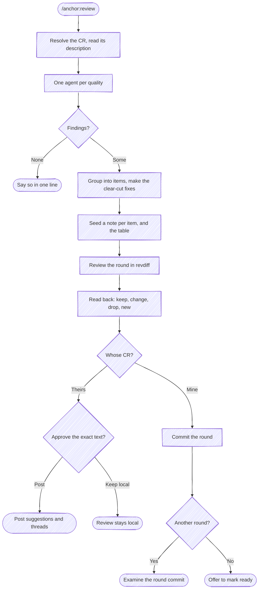

# Review

Take a change request and drive it to feedback in rounds. Each round examines the
diff against the qualities in `${CLAUDE_PLUGIN_ROOT}/templates/review-qualities.md`,
makes the fixes the agent would stand behind, and puts the whole result in front
of the user in revdiff: the CR's changes, the round's edits, and a note on every
item, with a table of the items beside them. What the user leaves in revdiff
decides what each item becomes.

Authorship picks where the result goes:

| The CR | Mode | Where the round's edits are made | What a kept item becomes |
|---|---|---|---|
| someone else's | **review** | a worktree at the CR head, in a temp directory | a suggestion or a thread, posted once the user approves the exact text |
| the user's own (`IS_OWN_CR=1`) | **self-review** | the user's checkout, on the CR's branch | part of the round's commit, made through `/anchor:commit`; nothing posts |

Self-review is the cold pass an author makes before handing a change to anyone
else. `/anchor:prepare-review` opens the CR as a draft so that decision stays
theirs, and this is where they make it. This skill is also the other side of
`/anchor:resolve-feedback`: that one brings a reviewer's findings back into a
branch, this one produces them.

**Recording a verdict is not this skill's act.** Approving a CR (`gh pr review
--approve`, `glab mr approve`) is the one irreversible thing in the flow and it
belongs to the human reviewer. This skill posts comments, suggestions, and
threads, and says so; it never approves and never requests changes as a forge
state.

**revdiff is required.** The round is reviewed through notes preloaded into the
diff, and revdiff is the viewer that takes them (`--annotations`) and hands back
what the user left. This skill runs revdiff whatever `anchor.diff.tool` names;
the other skills keep that key.

CR = change request: a pull request on GitHub, a merge request on GitLab. Pick
the forge tool by the resolved CR, not by the working directory's `origin`.

**Don't narrate your work.** Follow `${CLAUDE_PLUGIN_ROOT}/guides/execute-quietly.md`.
Surface only the resolved CR in one line, the Step 1 questions, the manifest as
the review opens, the questions Step 6 asks, the exact text of what will post,
and what landed where. The quality agents finish one at a time; wait for all of
them and say nothing as each arrives. Helper output, the items file, and the
agents' raw reports are inputs, never part of the reply.



## Task tracking when orchestrated

Settle whether the task tools exist and whether an orchestrator owns the list as
`${CLAUDE_PLUGIN_ROOT}/guides/task-tracking.md` describes. With the tools and no
orchestrator, enumerate:

- `Fetch the change request`
- `Examine the diff against each quality`
- `Review the round in revdiff`
- `Commit the round` *(own CR)* or `Post the approved findings` *(someone else's)*

## Step 1: Resolve and fetch the change request

**Target repo.** Resolve it as the other `anchor` skills do. **With a name
argument**, resolve it with
`${CLAUDE_PLUGIN_ROOT}/scripts/resolve-target.sh <name>`: `TARGET_VIA=resolved` →
pass `TARGET_LOCAL` as `--repo`; empty `TARGET_LOCAL` → ask where the checkout
lives; `ambiguous` → prompt with `TARGET_CANDIDATES`; `cwd` → the working
directory's repo. **With a CR URL**, the URL names the project; if that project
isn't the cwd repo, resolve its checkout the same way before continuing.

Then gather everything in one call:

```bash
bash "${CLAUDE_PLUGIN_ROOT}/scripts/review-cr.sh" <number|url|branch> [--repo <path>]
```

With no argument it resolves the open CR for the current branch. Act only on
what it surfaces:

| Key | What to do with it |
|-----|--------------------|
| `FORGE` / `HOST` / `PROJECT` | pick the CLI and target it; `HOST` is `glab --hostname` on self-hosted GitLab |
| `CR_IID` / `CR_URL` / `CR_TITLE` / `CR_AUTHOR` | the one line you report, and the review's header |
| `CR_REF` | how the CR is named in prose and titles (`<repo> !<iid>`, `<repo> #<num>`), so its number never reads as a count |
| `CR_STATE` | anything but `open` → say what state it's in and ask before continuing |
| `CR_DRAFT=true` | on someone else's CR the author hasn't asked for review yet: say so and confirm. In self-review it is the expected state |
| `IS_OWN_CR=1` | a **self-review**. Say which mode you're in once |
| `CR_HEAD_SHA` / `CR_BASE_SHA` / `CR_START_SHA` | pinned at fetch time; the round starts from them and Step 8 passes them back |
| `DIFF_PATH` | the unified diff, for the examination |
| `DESC_PATH` | the description, read before the diff |
| `FINDINGS_PATH` | where Step 7 writes what will post; already seeded |
| `OPEN_THREADS` / `OPEN_THREADS_MINE` / `OPEN_FEEDBACK_PATH` | review threads already open on the CR; see "Open feedback comes first" below |

A `REVIEW_ERROR=…` line means there is nothing to review: surface it and stop.
On a 401/403 the same line carries the auth failure: ask the user to refresh
credentials rather than retrying or reaching for another endpoint.

**Open feedback comes first.** A new pass over a CR that already has open threads
puts fresh findings on top of questions nobody has answered. When
`OPEN_THREADS` is above zero:

- **Your own CR**: those threads are feedback waiting on you, and
  `/anchor:resolve-feedback` is the skill that works them. Say how many are open
  and who started them, then ask with `AskUserQuestion` (header `Open feedback`):
  **Resolve the feedback first** *(default)*, which hands off to
  `/anchor:resolve-feedback` and offers this review again once it's done, or
  **Review anyway**.
- **Someone else's CR**: read `OPEN_FEEDBACK_PATH` and check each thread against
  the head before examining anything new. The question is whether the author
  answered it: a thread the head now addresses, one it doesn't, and one that is
  still a live conversation. Say that in one table (thread, its file and line,
  addressed or not), and give the examination in Step 3 the open threads so no
  agent raises one of them again as its own finding. A thread you started
  (`mine: true`) that the head addresses is worth resolving; offer to, and do it
  only on a yes, with the invocation in `${CLAUDE_PLUGIN_ROOT}/guides/forge-cookbook.md`.

**Check revdiff can open before spending anything on agents:**

```bash
bash "${CLAUDE_PLUGIN_ROOT}/scripts/review-diff.sh" --skill review --tool revdiff --probe
```

`REVIEW_AVAILABLE=0` stops the review here. Say that `/anchor:review` needs
revdiff (`brew install umputun/apps/revdiff`, or https://revdiff.com) and, when
`revdiff` is on `PATH`, that there is nowhere in this session to open it (see
the configuring guide's "Where a review opens"). Nothing has been examined or
written yet, so there is nothing to clean up.

## Step 2: Read the description before the diff

Read `DESC_PATH` first, in full. The description states what the change is
*for*, and that is what decides whether the diff is a good answer. Take from it
the problem the author says they're solving, the approach they chose, anything
they flagged as contested or unverified, and any Review guide pointing at where
they want attention. A change whose reason is missing is itself a finding, and a
better one than most line-level remarks.

Then read `DIFF_PATH` against that. Where the diff does something the description
doesn't account for, that gap is the highest-value thing you have.

## Step 3: Examine the diff against each quality

**Read `${CLAUDE_PLUGIN_ROOT}/templates/review-qualities.md` before the
examination.** It is the user's file: the qualities it lists are the review's
scope, and its Output section is the bar a finding has to clear. Weigh every
quality it lists and none it doesn't.

**One agent per listed quality**, launched in a single message so they run
concurrently. Each gets the diff (`DIFF_PATH` on the first round; the round
commit's diff on a later one, see Step 7), what Step 2 established the change is
for, one quality's name and wording verbatim, the template's Output section, and
from round 2 on the ledger's `rejected` list as settled: what the user dropped is
not raised again unless the code has since changed in a way that makes it newly
valid. Nothing about the other qualities, and no number of findings to aim for:
independent lenses are the point, and a quota is what fills a review with
filler.

What the agents return are **candidates**, not findings.

### Judge the candidates

Four lenses each find something; whether it is worth the user's attention is a
judgment none of them made. Make it here, once, over the merged list, holding
every candidate to the template's Output section:

- **Confirm it, or drop it.** Read the code the candidate rests on. One the
  surrounding code already prevents, or one still hedged (*might*, *could*,
  *appears to*) after you've looked, is dropped.
- **Two candidates one change resolves are one.** Keep the more specific.
- **Critical or suggestion**, by the template's definitions. When unsure, it is
  a suggestion. A suggestion that wouldn't change what the author does is
  dropped.
- **Look ahead.** For each one you keep, would its fix draw a finding of its
  own? Fold that in now, so the next round doesn't review this round's fixes.
- **Score the change's risk**, 1 to 5: trivial, small and contained, real logic
  or shared paths, critical paths or data, must not ship as written. The score
  sets how hard to hold suggestions to the bar: on a 1 or 2, a suggestion has to
  be plainly worth a round trip.

There is no number to reach. Say in the manifest how many candidates came back
and how many survived, so a short review reads as judged rather than shallow.

**No findings is a finished review.** Say so in one line, with the risk score.
On someone else's CR nothing posts. In self-review, go straight to the handoff
(Step 7, item 5).

## Step 4: Triage the findings into items, and act on the clear ones

An **item** is one fix: findings that one change resolves are one item, whatever
quality raised them. Give each:

- an **id** (1, 2, …, continuing across rounds), a kebab-case **slug**, and the
  **severity** the judge gave it: `critical` or `suggestion`, as the template
  defines them. An item resting on something you couldn't confirm says so in
  its reason, and is a suggestion.
- a **status**: `applied` when you make the fix now, `proposed` when you'd ask
  first, `issue` when it belongs in its own change, `leave` when you'd let it
  land as is.

**Start the round** before editing anything:

```bash
bash "${CLAUDE_PLUGIN_ROOT}/scripts/review-round.sh" start --base <CR_BASE_SHA> --head <CR_HEAD_SHA> \
  (--worktree | --in-place) [--ledger <ROUND_LEDGER>] [--repo <path>]
```

**Rounds are counted.** The first round's `start` prints `ROUND_LEDGER`; pass it
to every later round's `start`, which makes that round `ROUND_N=2`, `3`, and so
on, with `ROUND_PREVIOUS` listing what each earlier round changed as a percent of
the CR's own diff. From round 2 on, say which round this is whenever you talk
about it: a review that loops is easier to stop when it says *round 4*. The
first round is just *the review*; numbering it makes the reader ask what a round
is before they know what they're looking at.

`--worktree` on someone else's CR; `--in-place` on your own. An in-place round
refuses a checkout that isn't on the CR head or has uncommitted changes
(`ROUND_ERROR`): say what it found and stop, since a round's edits have to be the
only changes in the tree. Keep `ROUND_DIR`, `ROUND_ROOT`, and `ROUND_BASE`; every
edit below happens under `ROUND_ROOT`.

**Apply a critical item's fix when it stays local** to the code it fixes and
you'd stand behind it. A suggestion stays a proposal, and so does anything you
would ask about or that reaches into callers and other files: every fix applied
here is diff the next round reviews. Apply one item at a time
and record it the moment it's done:

```bash
bash "${CLAUDE_PLUGIN_ROOT}/scripts/review-round.sh" record --dir <ROUND_DIR> --id <n>
```

The recorded patch is what lets one item be reverted later without touching the
others, and what turns a fix on someone else's CR into a suggestion. Run the
project's tests over an in-place round's applied items before seeding.

## Step 5: Seed the notes and the table

Write the items to a file in the shape `scripts/review-round.sh` documents at its
top, and seed the round:

```bash
bash "${CLAUDE_PLUGIN_ROOT}/scripts/review-round.sh" seed --dir <ROUND_DIR> --items <items.json> \
  --title 'Review of <CR_REF>: <CR_TITLE>' --cr-url <CR_URL>
```

Each item's **sites** are the lines it touches, numbered in the tree as it now
stands: the first line of each edit for an applied item, or the line the change
would go on for a proposal. A site without a line is for an item about a file as
a whole; the rest of the placement rules are in
`${CLAUDE_PLUGIN_ROOT}/guides/running-a-review.md` ("Put each note where the
reader is already looking"). The script puts one note per item above its first
site, names the item's other sites at the end of it, and writes `(context).md` at
the root of the tree with a row per item.

The **reason** is what the user reads beside the code, and on someone else's CR
it becomes what posts. Write it as the thing the reviewer would type:

- **State the consequence, not the observation.** *"This drops the tenant from
  the cache key, so two tenants share an entry"*, not *"cache key changed"*.
- **For a proposal, say what the change would touch**: this line, this function,
  or callers in other files. That is most of the decision.
- **Ask when it is a question**, and point at the alternative in one clause when
  there is one.

The register is `anchor`'s everywhere: plain words, no loaded framing
(`${CLAUDE_PLUGIN_ROOT}/guides/loaded-framing.md`), no praise padding.

`ROUND_ERROR` lines name sites revdiff would drop silently (a file the review
doesn't change, a line past the end); fix those sites and seed again.

## Step 6: Review the round in revdiff

Launch it as `${CLAUDE_PLUGIN_ROOT}/guides/running-a-review.md` describes: in the
background, with the manifest, and holding on chat feedback while it's open.

```bash
bash "${CLAUDE_PLUGIN_ROOT}/scripts/review-diff.sh" --skill review --tool revdiff --mode diff \
  --repo <ROUND_ROOT> <ROUND_BASE> --untracked --annotations <NOTES> \
  --title 'Review of <CR_REF>: <CR_TITLE>' --detail CR=<CR_URL> --detail author=<CR_AUTHOR> \
  [--detail 'earlier rounds=<ROUND_PREVIOUS> of the CR']
```

The diff runs from the merge base to the round's tree, so it holds the CR's
whole change and the round's edits together, with `(context).md` at the root of
the file tree and `--untracked` adding any file the round creates.

**The manifest** says what is in front of the user: the CR, the round number
from round 2 on, its author, the items by status (`3 applied, 2 proposed`), and how to answer.
From round 2 on, add the trend table `review-round.sh trend --ledger
<ROUND_LEDGER>` prints, one row per finished round. Carry the answer
key into the reply, since nobody should have to open the table to learn it:

> Answer on each item's note. Leave it, or answer `ok` / 👍, to keep it.
> Delete it, or answer `drop` / `no`, to drop it. Write anything else to change
> it, and add a note of your own for anything new. A note far from the changes
> is in `(context).md` instead; answer it on its row the same way. Quit with `q`.

When it closes, read `REVIEW_RETURNED` from its output. `approved` and
`changes-requested` both mean the review ran; the returned notes are the answer.
`no-verdict`, or no `REVIEW_RETURNED` line, means it didn't: open and close the
reply with the error banner, say what `raw.exitCode` names, and ask whether to
open it again or stop. Nothing about the round is lost by stopping; finish it
(Step 9) so the tree is left as it was.

## Step 7: Act on what the user left

```bash
bash "${CLAUDE_PLUGIN_ROOT}/scripts/review-round.sh" read --dir <ROUND_DIR> --returned <REVIEW_RETURNED>
```

`ROUND_READ` is the item-by-item answer. Act on each decision:

| Decision | Meaning | Act |
|---|---|---|
| `keep` | note left as seeded, or answered with a yes (`ok`, `apply`, 👍) | the item stands as it was |
| `change` | anything else written on the note, a row edited, or a note left on a row | do what the text says, which may change the fix, its status, or drop it |
| `drop` | the note deleted or answered `drop` / `no` / `leave`, or the row deleted | revert it if applied (`review-round.sh revert --id <n>`); nothing else |

`added` notes are the user's own findings: keep their wording verbatim, decide
whether each is a fix or a proposal, and treat it as a kept item. `userEdits`
names a patch the user made from inside revdiff: it is their own fix, read per
`${CLAUDE_PLUGIN_ROOT}/guides/reviewer-edits.md`, and it stays in the tree.

A changed item that changes its fix is reverted, re-edited, and recorded again.
`revert` refuses when a later item edited the same lines; say which, and make the
change by hand.

### Your own CR: commit the round

1. Implement the kept proposals, then the changes the notes asked for. File each
   `issue` item through `/anchor:issue`, seeded with its reason.
2. List the round's files, then finish the round (Step 9), which takes
   `(context).md` out of the tree and records the round in the ledger:
   `review-round.sh files --dir <ROUND_DIR>` prints one `ROUND_FILE=` per path.
3. Hand those paths to `/anchor:commit` as `--path` arguments, with each kept
   item's reason as its note (REVIEW-30): a notes file in the shape
   `review-explain.sh` reads, one note per item on its first site, numbered in
   the tree as it now stands (the edits since the round may have moved it), its
   text the item's reason. `/anchor:commit` seeds those as its review's notes, so
   the reasons you read in the round are back on their lines in the diff that
   lands. It runs the tests, opens one review of the round's exact diff with its
   drafted message, and commits and pushes on approval. That review is not a
   repeat: the tree changed after the annotated round, and this is the diff that
   lands. Draft the message to name the items the round fixed; the notes carry
   why each one is the way it is.
4. **Offer another round** with `AskUserQuestion` (header `Round <ROUND_N + 1>`),
   scoped to the round commit's diff: the agents in Step 3 examine only what
   this round changed. The user may be answering after an hour on another tab,
   so the question carries its own context: open with the repo and the CR in
   full (`sextant #23: Number a refinement after the requirement it refines`),
   say in a sentence what this round fixed, by what the fixes were rather than
   by item number, and say what another round would do in plain words (*re-read
   only the lines this round changed, and open revdiff again if anything turns
   up*). Show how much each round changed as the `preview` of both options:
   the bars `review-round.sh sizes --ledger <ROUND_LEDGER>` prints, each round's,
   newest first, over the CR's, verbatim. The question text renders a markdown table as
   raw pipes and a percent per round has to be read and held in the head, where
   bars on one scale show at a glance whether the rounds are shrinking; that
   trend is the answer to whether another round is worth it. The
   same opening goes on the `Handoff` question below. Recommend another
   round only when this one applied a `critical` fix, since a fix to a real bug
   can carry one of its own; otherwise recommend stopping, and say so plainly
   when the percent didn't fall from the round before. The default is to stop:
   suggestions polish, and a round of polish is the next round's diff. Declining ends the
   review. A later round starts again at Step 3 against the new head (re-run
   Step 1 to pin it), with the same ledger.
5. **Hand it off.** Ask (header `Handoff`):

   - **Mark ready and request reviewers**: ask who, then do both.
   - **Mark ready**: ready with no reviewer named.
   - **Leave it a draft** *(default)*: a finished outcome; say so and stop.

   Clear the draft flag through the helper, which reads it fresh, covers both
   forges, and announces `cr.ready`:

   ```bash
   bash "${CLAUDE_PLUGIN_ROOT}/scripts/mark-ready.sh" --forge <FORGE> --cr <CR_IID>
   ```

   `ALREADY_READY=1` means someone got there first; say that. Requesting
   reviewers is a separate call, in `${CLAUDE_PLUGIN_ROOT}/guides/forge-cookbook.md`.

### Someone else's CR: build what will post

Write the kept items into `FINDINGS_PATH` (its shape is in Step 8), in id order,
each at the line it maps to in the CR head:

- **An applied item** asks for a suggestion:

  ```bash
  bash "${CLAUDE_PLUGIN_ROOT}/scripts/review-round.sh" suggest --dir <ROUND_DIR> --id <n> --forge <FORGE>
  ```

  `SUGGESTIBLE=1` gives a `SUGGESTION` with the anchor and the fenced block;
  the body is the reason, a blank line, then the block. `SUGGESTIBLE=0` (a fix
  across hunks or files) posts as a thread carrying the reason and a sentence on
  what the fix changes.
- **A proposal** posts as a thread carrying its reason, anchored at its first
  note's `crLine`. A `crLine` of `null` sits on a line the round added; anchor
  it as a file comment instead.
- **An added note** posts verbatim at its `crLine`, `origin: "reviewer"`.
- **`issue` and `leave` items** don't post. Offer `/anchor:issue` for each
  `issue` item, seeded with its reason.

Write `summary` last: whether the change does what its description claims, and
the one thing most worth attention. It is not a verdict.

## Step 8: Approve the exact text, then post (someone else's CR)

Everything below posts under the user's name with nothing marking it as drafted
by an agent, so the words are theirs to approve. The revdiff round chose *what*
posts; this gate approves the *words*. The findings file entries use the DIFF
contract's comment shape:

```json
{
  "cr": {"url": "<CR_URL>", "headSha": "<CR_HEAD_SHA>"},
  "summary": "the overall read",
  "comments": [
    {"body": "…", "target": "line", "file": "<path>",
     "startLine": <n>, "endLine": <n>, "side": "new", "origin": "agent"}
  ]
}
```

Render it, and put the output in your reply:

```bash
bash "${CLAUDE_PLUGIN_ROOT}/scripts/review-post.sh" --preview --findings <FINDINGS_PATH> --diff <DIFF_PATH>
```

If nothing was kept, there is nothing to approve: report the review as local and
stop. Otherwise ask with `AskUserQuestion` (header `Post`):

- **Post all** *(default)*: every thread plus the summary.
- **Post one at a time**: walk the numbered findings, confirming each.
- **Keep it local**: a finished outcome; say where the findings file is and stop.

A revision re-renders and comes back here. Approval of one round is not approval
of the next. Then post:

```bash
bash "${CLAUDE_PLUGIN_ROOT}/scripts/review-post.sh" --post \
  --findings <FINDINGS_PATH> --diff <DIFF_PATH> --forge <FORGE> --project <PROJECT> --cr <CR_IID> \
  [--host <HOST>] --base-sha <CR_BASE_SHA> --start-sha <CR_START_SHA> \
  [--index <n|summary>]
```

Without `--index` everything posts: on GitHub as one batched review, on GitLab
as one thread per finding. `POST_ERROR=head-moved` means the author pushed while
the review was open: report both SHAs and offer to re-run from Step 1, and never
re-anchor by guessing. Any other `POST_ERROR` is the forge refusing a write
partway: `POSTED_INLINE` and `POSTED_SUMMARY` say what landed, so offer the rest
with `--index` rather than re-posting everything.

## Step 9: Finish the round

```bash
bash "${CLAUDE_PLUGIN_ROOT}/scripts/review-round.sh" finish --dir <ROUND_DIR>
```

It appends the round to the ledger (the items by status, what your notes said
and how many lines they ran to, the lines the round changed, and that as a
percent of the CR), prints `ROUND_PERCENT`, then removes `(context).md` and the
round's state, and on someone else's CR the worktree. Run it once the round's edits are committed or posted, and on any
stop after Step 4, so no review worktree or table outlives the review.

## Step 10: Report

**After a post.** One line per finding: `#N <file:line> — suggestion posted` or
`— thread posted`, the summary comment's outcome, and the CR URL. Name what did
not post: dropped items, `leave` items, and issues filed. Close by naming the
verdict as the user's to record:

```text
Comments posted. Recording a verdict is yours:
  gh pr review <n> --approve          # or --request-changes
  glab mr approve <iid>
```

**After a self-review.** The trend table, then one line per round: the commit
and the items it fixed. Then the dropped items, the issues filed, the CR's state
(still a draft, or ready with whoever was requested), and the CR URL.

## Related

`/anchor:prepare-review` writes the description this skill reads first;
`/anchor:resolve-feedback` is what the author runs when these findings reach
them. The forge invocations behind Step 8 (line-anchored threads, the batched
review, the GitLab position payload) are in
`${CLAUDE_PLUGIN_ROOT}/guides/forge-cookbook.md`.
