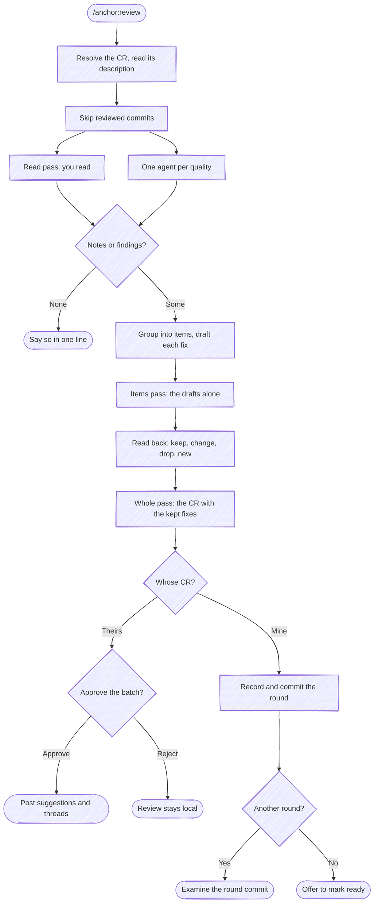

# Review

Take a change request and drive it to feedback in rounds. Each round examines the
diff against the qualities in `${CLAUDE_PLUGIN_ROOT}/templates/review-qualities.md`,
drafts a fix for each finding, and puts it in front of the user in revdiff:

| Pass | Diff | What the user does |
|---|---|---|
| **read** | the range's base → the CR head: the change as written | reads it and leaves notes of their own, while the quality agents examine the same range |
| **items** | the CR head → the round's tree: the drafts alone, a note on each | keeps, changes, or drops each item, without the CR's own change around it |
| **whole** | the range's base → the round's tree: the CR with the kept fixes in it | decides whether the change, as it will land, is right |

The read pass opens at once, so the user is never waiting on agents: reading
the change is the review's first step whether or not the agents find anything,
and the agents' minutes are spent while the user reads. Deciding each item comes
next, because a draft read inside a large CR's diff is hard to tell from the
change it's commenting on. Each pass has a `(context).md` table beside the diff.

Authorship picks where the result goes:

| The CR | Mode | Where the round's edits are made | What a kept item becomes |
|---|---|---|---|
| someone else's | **review** | a worktree at the CR head, in a temp directory | a suggestion or a thread, posted once the user approves the exact text |
| the user's own (`IS_OWN_CR=1`) | **self-review** | the user's checkout, on the CR's branch | part of the round's commit, made through `/anchor:commit`; nothing posts |

**On someone else's CR, nothing the review drafts is shown as code in the
change.** The user is reviewing what will ship, and a fix the agent drafted
ships only if the author takes it. So the items pass there diffs the CR as its
author wrote it, each fix is described in words in its item's note headed 💡,
its code held back for the batch of comments in Step 8,
and there is no whole pass: the CR with someone else's fixes in it is not a
change anyone will merge. `review-round.sh seed` does this on a worktree round
(REVIEW-22).

**Every examination is the user's call** (REVIEW-38). A review spends tokens by
the agent and by the round, so the quality agents run, and another round or
pass opens, only on a yes to a question asked in this invocation: the `Agents`
question in Step 3, asked once the read pass is open so reading never waits on
it, the `Round` question in Step 7, the `Reopen` question after
a whole pass that asked for changes. Don't infer a yes from an earlier review,
an earlier round, or the user's having said "review" once.

A branch that has never had a CR (`HAS_CR=0`) is a self-review of its commits
ahead of `BASE_BRANCH`: the default branch, or the branch of the open CR it is
stacked on, whose commits that CR reviews. Its rounds go to a local record in the repo's git
directory, read the same way, until `/anchor:prepare-review` opens the CR and
carries them into its description.

Self-review is the cold pass an author makes before handing a change to anyone
else. `/anchor:prepare-review` opens the CR as a draft so that decision stays
theirs, and this is where they make it. This skill is also the other side of
`/anchor:resolve-feedback`: that one brings a reviewer's findings back into a
branch, this one produces them.

**Recording a verdict is not this skill's act.** Approving a CR (`gh pr review
--approve`, `glab mr approve`) is the one irreversible thing in the flow and it
belongs to the human reviewer. This skill posts comments, suggestions, and
threads, and says so; it never approves and never requests changes as a forge
state.

**revdiff is required.** The round is reviewed through notes preloaded into the
diff, and revdiff is the viewer that takes them (`--annotations`) and hands back
what the user left. Every diff review runs revdiff, and `anchor.diff.tool` is
ignored in 2.0.

CR = change request: a pull request on GitHub, a merge request on GitLab. Pick
the forge tool by the resolved CR, not by the working directory's `origin`.

**Don't narrate your work.** Follow `${CLAUDE_PLUGIN_ROOT}/guides/execute-quietly.md`.
Surface only the resolved CR in one line, the Step 1 questions, the manifest as
each pass opens, the questions Steps 1, 3, 6, and 7 ask, the batch of comments that will post (never
the comments themselves in the reply),
and what landed where. The quality agents finish one at a time; wait for all of
them and say nothing as each arrives. Helper output, the items file, and the
agents' raw reports are inputs, never part of the reply.



## Task tracking when orchestrated

Settle whether the task tools exist and whether an orchestrator owns the list as
`${CLAUDE_PLUGIN_ROOT}/guides/task-tracking.md` describes. With the tools and no
orchestrator, enumerate:

- `Fetch the change request`
- `Read the change in revdiff`
- `Examine the diff against each quality`
- `Decide each item in revdiff`
- `Review the whole change in revdiff`
- `Commit the round` *(own CR)* or `Post the approved findings` *(someone else's)*

## Step 1: Resolve and fetch the change request

**Target repo.** Resolve it as the other `anchor` skills do. **With a name
argument**, resolve it with
`${CLAUDE_PLUGIN_ROOT}/scripts/resolve-target.sh <name>`: `TARGET_VIA=resolved` →
pass `TARGET_LOCAL` as `--repo`; empty `TARGET_LOCAL` → ask where the checkout
lives; `ambiguous` → prompt with `TARGET_CANDIDATES`; `cwd` → the working
directory's repo. **With a CR URL**, the URL names the project; if that project
isn't the cwd repo, resolve its checkout the same way before continuing.

Then gather everything in one call:

```bash
bash "${CLAUDE_PLUGIN_ROOT}/scripts/review-cr.sh" <number|url|branch> [--repo <path>]
```

With no argument it resolves the current branch's CR, or the branch itself
where it has never had one. Act only on what it surfaces:

| Key | What to do with it |
|-----|--------------------|
| `FORGE` / `HOST` / `PROJECT` | pick the CLI and target it; `HOST` is `glab --hostname` on self-hosted GitLab |
| `HAS_CR=0` | the branch has no CR: a self-review of its commits ahead of `BASE_BRANCH` (the default branch, or the open CR's branch it is stacked on). `CR_IID`, `CR_URL`, `CR_STATE`, and `CR_DRAFT` are empty, so the rows that act on them don't apply; `CR_REF` names the repo and the branch. Say in the one line that it has no CR yet |
| `CR_IID` / `CR_URL` / `CR_TITLE` / `CR_AUTHOR` | the one line you report, and the review's header |
| `CR_REF` | how the CR is named in prose and titles (`<repo> !<iid>`, `<repo> #<num>`), so its number never reads as a count |
| `CR_STATE` | anything but `open` → say what state it's in and ask before continuing |
| `CR_DRAFT=true` | on someone else's CR the author hasn't asked for review yet: say so and confirm. In self-review it is the expected state |
| `IS_OWN_CR=1` | a **self-review**. Say which mode you're in once |
| `CR_HEAD_SHA` / `CR_BASE_SHA` / `CR_START_SHA` | pinned at fetch time; the round starts from them and Step 8 passes them back |
| `DIFF_PATH` | the unified diff, for the examination |
| `DESC_PATH` | the description, read before the diff |
| `FINDINGS_PATH` | where Step 7 writes what will post; already seeded |
| `OPEN_THREADS` / `OPEN_THREADS_MINE` / `OPEN_FEEDBACK_PATH` | review threads already open on the CR; see "Open feedback comes first" below |
| `REVIEW_STATUS_*` | which commits the CR's Review status section says are unreviewed: by anyone on your own CR, by you on someone else's; and how many of those the user approved when `/anchor:commit` made them (`REVIEW_STATUS_COMMITTED`, timed `_FIRST` to `_LAST`). See "Start where the last review stopped" below |
| `REVIEW_DECISIONS_PATH` | what earlier reviews recorded in that section's Notes (REVIEW-34), as a JSON array; settled, see Step 3 |

A `REVIEW_ERROR=…` line means there is nothing to review: surface it and stop.
On a 401/403 the same line carries the auth failure: ask the user to refresh
credentials rather than retrying or reaching for another endpoint.

**Open feedback comes first.** A new pass over a CR that already has open threads
puts fresh findings on top of questions nobody has answered. When
`OPEN_THREADS` is above zero:

- **Your own CR**: those threads are feedback waiting on you, and
  `/anchor:resolve-feedback` is the skill that works them. Say how many are open
  and who started them, then ask with `AskUserQuestion` (header `Open feedback`):
  **Resolve the feedback first** *(default)*, which hands off to
  `/anchor:resolve-feedback` and offers this review again once it's done, or
  **Review anyway**.
- **Someone else's CR**: read `OPEN_FEEDBACK_PATH` and check each thread against
  the head before examining anything new. The question is whether the author
  answered it: a thread the head now addresses, one it doesn't, and one that is
  still a live conversation. Say that in one table (thread, its file and line,
  addressed or not), and give the examination in Step 3 the open threads so no
  agent raises one of them again as its own finding. A thread you started
  (`mine: true`) that the head addresses is worth resolving; offer to, and do it
  only on a yes, with the invocation in `${CLAUDE_PLUGIN_ROOT}/guides/forge-cookbook.md`.

**Start where the last review stopped.** The CR's Review status section counts
the review rounds each commit has been in and who reviewed it (REVIEW-31), or
on a branch with no CR the local record does, and `REVIEW_STATUS_*` is what it
says now. On your own CR a commit any round covered
is reviewed; on someone else's, only one you reviewed is. A commit the user
only approved when `/anchor:commit` made it is **not** reviewed: that was a look
at one increment before it landed, not this review, and the question below says
so rather than counting it either way. A reviewed commit
isn't reviewed again unless the user asked for the whole CR when invoking the
skill (*review the whole thing*, *re-review*, *from the start*). Pick the range
before anything opens:

- **The user asked for the whole CR**, or **no commit is reviewed**
  (`REVIEW_STATUS_UNREVIEWED` equals `REVIEW_STATUS_COMMITS`): review the whole
  CR, without asking.
- **Some reviewed, some not**: review the unreviewed commits, without asking,
  from `REVIEW_STATUS_OLDEST` to the head, so the range takes in the newest
  unreviewed commit and any reviewed one between them. Say so in the one line
  that reports the CR, naming how many commits were skipped.
- **Every commit reviewed** (`REVIEW_STATUS_UNREVIEWED=0`): ask with
  `AskUserQuestion` (header `Reviewed`), saying that every commit has had a
  round. On your own CR: **Hand it off** *(default)*, which goes to Step 7,
  item 5 (mark it ready, request reviewers); **Re-review the whole CR**;
  **Stop**. On someone else's: **Stop** *(default)*; **Re-review the whole CR**.

Call the range's base `REVIEW_BASE`: `REVIEW_STATUS_FROM` for the unreviewed
commits, `CR_BASE_SHA` for the whole CR. On the unreviewed commits,
`REVIEW_STATUS_DIFF_PATH` takes the place of `DIFF_PATH` everywhere below.

**Check revdiff can open before anything else:**

```bash
bash "${CLAUDE_PLUGIN_ROOT}/scripts/review-diff.sh" --skill review --tool revdiff --probe \
  --title 'Review of <CR_REF>: <CR_TITLE>' [--detail CR=<CR_URL>] --detail author=<CR_AUTHOR>
```

`REVIEW_AVAILABLE=0` stops the review here. Say that `/anchor:review` needs
revdiff 1.14 or later, from its install page
(https://github.com/umputun/revdiff#installation). When the probe printed `REVIEW_UNUSABLE`, relay that line,
which names the installed version and the upgrade. Otherwise, when `revdiff` is
on `PATH`, say that there is nowhere in this session to open it (see the
configuring guide's "Where a review opens"). Nothing has been examined or
written yet, so there is nothing to clean up.

## Step 2: Read the description before the diff

Read `DESC_PATH` first, in full. On a branch with no CR it holds the commit
messages, oldest first. The description states what the change is
*for*, and that is what decides whether the diff is a good answer. Take from it
the problem the author says they're solving, the approach they chose, anything
they flagged as contested or unverified, and any Review guide pointing at where
they want attention. A change whose reason is missing is itself a finding, and a
better one than most line-level remarks.

Then read `DIFF_PATH` against that. Where the diff does something the description
doesn't account for, that gap is the highest-value thing you have.

The `<!-- anchor:review-status … -->` comment in the description is anchor's
record of the review rounds, not the author's prose; leave it out of the examination.

## Step 3: Read the change while the agents examine it

**Start the round** before anything opens:

```bash
bash "${CLAUDE_PLUGIN_ROOT}/scripts/review-round.sh" start --base <REVIEW_BASE> --head <CR_HEAD_SHA> \
  (--worktree | --in-place) [--ledger <ROUND_LEDGER>] [--repo <path>]
```

`--worktree` on someone else's CR; `--in-place` on your own. An in-place round
refuses a checkout that isn't on the CR head, has uncommitted changes, or has
untracked files (`ROUND_ERROR`): say what it found and stop, since a round's
edits have to be the only changes in the tree. Keep `ROUND_DIR`, `ROUND_ROOT`,
`ROUND_BASE`, and `ROUND_HEAD`; every edit below happens under `ROUND_ROOT`.

**A later round you offered** (Step 7, item 4) skips Steps 1 and 2 and starts
here with `--next-round` in place of `--base`:

```bash
bash "${CLAUDE_PLUGIN_ROOT}/scripts/review-round.sh" start --next-round --ledger <ROUND_LEDGER> \
  --head HEAD --in-place [--repo <path>]
```

It takes the base from the ledger: the head the previous round reviewed, so the
range is only the round's commit. From here on `ROUND_BASE` stands in for
`REVIEW_BASE` and `ROUND_HEAD` for `CR_HEAD_SHA`.

**Rounds are counted.** The first round's `start` prints `ROUND_LEDGER`; pass it
to every later round's `start`, which makes that round `ROUND_N=2`, `3`, and so
on, with `ROUND_PREVIOUS` listing what each earlier round changed as a percent of
the CR's own diff. From round 2 on, say which round this is whenever you talk
about it: a review that loops is easier to stop when it says *round 4*. The
first round is just *the review*; numbering it makes the reader ask what a round
is before they know what they're looking at.

**Seed the read pass** (the first round only; a later round, offered in Step 7,
item 4, is agents only, since its range is the previous round's commit, which
the user just read line by line in the whole pass):

```bash
bash "${CLAUDE_PLUGIN_ROOT}/scripts/review-round.sh" seed --dir <ROUND_DIR> --pass read \
  [--threads <OPEN_FEEDBACK_PATH>] --title 'Review of <CR_REF>: <CR_TITLE>' [--cr-url <CR_URL>]
```

Pass `--threads` when `OPEN_THREADS` is above zero, so the open threads are
listed in `(context).md` where the user can see what is still unresolved. Every
seed and launch below leaves out `--cr-url` and `--detail CR=` where `HAS_CR=0`.

**Open the read pass at once.** Reading the change is the review's first step
whatever else happens, so the user never waits on a question or an agent to
start. The read pass is the revdiff launch in Step 6, from `ROUND_FROM`, with no
`--annotations` (`NOTE_COUNT=0`: the read pass has no notes until the user
writes one). Its manifest says this is the change as written, which commits it
covers (and how many were skipped as already reviewed), and how to answer:
leave a note on anything to change, then a single note in `(context).md` saying
`approve` to go on or `reject` to stop. Don't touch `ROUND_ROOT` while the read
pass is open: the user is reading that tree, and an edit there would land in
what they are reviewing.

**Then, while it's open, ask whether to run the agents** (REVIEW-38), with
`AskUserQuestion` (header `Agents`). The quality agents run one per quality and
cost tokens accordingly, so they run only on a yes. The question names the
range (the CR, and how many commits) and, when `REVIEW_STATUS_COMMITTED` is
above zero, audits what the user already did with it, in their terms: *You
approved 3 of these 4 commits when committing them (Nov 10, 14:02 – Nov 12,
09:40).* Render that span from `REVIEW_STATUS_COMMITTED_FIRST` and `_LAST` in
local time, one time where they are the same. When `REVIEW_STATUS_UNVERSIONED`
is above zero, say that many have rounds with no version, written by anchor
2.0.0 or earlier, which counted a commit approval as a review, so they may
never have had one; that is why they are in the range. The options:

| Option | Then | Recorded kind |
|---|---|---|
| **Run them while I read** | launch the agents now | `agent-assisted` |
| **Run them; I'll skip the read** | launch the agents; tell the user to close the read pass with `ZZ`, and their findings open in the items pass | `agents-only` |
| **No agents** | the user's notes from the read pass are the only items | `read-through` |

Recommend the first, unless the user approved every commit in the range at
commit (`REVIEW_STATUS_COMMITTED` equals the range's commits), when the second
is: they have read each one already. Skip the question only when the user's
invocation already chose (*just have the agents look*, *I'll read it myself*).
Stopping is the read pass's `reject`. The answer is the kind Step 9 records.

**Read `${CLAUDE_PLUGIN_ROOT}/templates/review-qualities.md` before the
examination.** It is the user's file: the qualities it lists are the review's
scope, and its Output section is the bar a finding has to clear. Weigh every
quality it lists and none it doesn't.

**One agent per listed quality**, launched on a yes to `Agents`, so they run
while the user reads. Each gets the diff (`DIFF_PATH` on the first round; on a later
one, `git diff <ROUND_BASE> <ROUND_HEAD>`), what Step 2 established the change is
for, one quality's name and wording verbatim, the template's Output section, and
as settled both the decisions in `REVIEW_DECISIONS_PATH` and, from round 2 on,
the ledger's `rejected` list: what the user dropped, in this session or an
earlier review, is not raised again unless the code has since changed in a way
that makes it newly valid. Nothing about the other qualities, and no number of findings to aim for:
independent lenses are the point, and a quota is what fills a review with
filler.

What the agents return are **candidates**, not findings. Judge them (below) as
they arrive, but draft nothing until the read pass closes.

**When the read pass closes**, read it back:

```bash
bash "${CLAUDE_PLUGIN_ROOT}/scripts/review-round.sh" read --dir <ROUND_DIR> --returned <REVIEW_RETURNED>
```

`rejected` stops the review: stop the agents still running (`TaskStop`), finish
the round (Step 9), and record nothing. The undecided and failed cases are
handled as in Step 6. Otherwise the user's `added` notes, and any `tableNotes`,
are their own findings: each becomes an item with `"from": "you"`, its reason
the note's wording verbatim. They skip the judgment below, since the user
already made it. `userEdits` is read per
`${CLAUDE_PLUGIN_ROOT}/guides/reviewer-edits.md` and stays in the tree.

When an agent is still running, ask with `AskUserQuestion` (header `Agents`),
saying how many of the quality agents have finished and how many notes the user
left:

- **Wait for them** *(default)*: the items pass opens once they're judged.
- **Go on with my notes only**: stop the rest (`TaskStop`); the review drafts
  only the user's notes, and is recorded as a read-through (Step 9). With no
  notes either, it is a finished review, below.

A review whose agents all finished keeps the kind the `Agents` answer chose,
whatever they found. On *No agents* there are none to wait for: the
user's notes are the round's items, and with none it is a finished review,
below.

### Judge the candidates

Each lens finds something; whether it is worth the user's attention is a
judgment none of them made. Make it here, once, over the merged list, holding
every candidate to the template's Output section:

- **Confirm it, or drop it.** Read the code the candidate rests on. One the
  surrounding code already prevents, or one still hedged (*might*, *could*,
  *appears to*) after you've looked, is dropped.
- **Two candidates one change resolves are one.** Keep the more specific.
- **Critical or suggestion**, by the template's definitions, and nothing else
  (REVIEW-28): worth halting the deploy, or small and easy to correct now (a
  typo, docs that contradict the code, an inconsistent name). One that is
  neither, a preference or a change as easy to make later, is dropped however
  true it is. When unsure whether it is critical, it is a suggestion only if it
  is also a small fix; otherwise it is dropped. Expect a few, not a list.
- **Look ahead.** For each one you keep, would its fix draw a finding of its
  own? Fold that in now, so the next round doesn't review this round's fixes.
- **Score the change's risk**, 1 to 5: trivial, small and contained, real logic
  or shared paths, critical paths or data, must not ship as written. The score
  sets how hard to hold suggestions to the bar: on a 1 or 2, a suggestion has to
  be plainly worth a round trip.

There is no number to reach. Say in the manifest how many candidates came back
and how many survived, so a short review reads as judged rather than shallow.

**No findings and no notes is a finished review.** Say so in one line, with the
risk score when the agents ran. Finish the round and record it as `approved`
(Step 9). On someone else's CR nothing posts. In self-review, go straight to
the handoff (Step 7, item 5).

## Step 4: Triage the findings into items, and act on the clear ones

An **item** is one fix: findings that one change resolves are one item, whatever
quality raised them. Give each:

- an **id** (1, 2, …, continuing across rounds), a kebab-case **slug**, and the
  **severity** the judge gave it: `critical` or `suggestion`, as the template
  defines them. An item resting on something you couldn't confirm says so in
  its reason, and is a suggestion.
- a **status**: `applied` when its fix is drafted in the tree, `proposed` when
  it has no code to draft (a question, or a change too broad to write before
  the author agrees to it), `issue` when it belongs in its own change, `leave`
  when you'd let it land as is.

The user's notes from the read pass are items like any other, marked
`"from": "you"`: the items pass labels each one *your note*, so the user can
tell their own from the agents'.

**Draft every item's fix** that can be written as code, critical or
suggestion. A draft is not a decision: the items pass shows each one on its own
so the user keeps or drops it, and a dropped draft is reverted before anything
lands. Write each draft as the fix you'd stand behind if it were kept, since a
kept draft is diff the next round reviews. Draft one item at a time and record
it the moment it's done:

```bash
bash "${CLAUDE_PLUGIN_ROOT}/scripts/review-round.sh" record --dir <ROUND_DIR> --id <n>
```

The recorded patch is what lets one item be reverted later without touching the
others, and what turns a fix on someone else's CR into a suggestion. Run the
project's tests over the kept items before the whole pass (Step 7), not over
every draft.

On someone else's CR the drafts are the agent's working, not something to show
as code: Step 5's seed parks them, so the user sees the CR as its author wrote
it and each fix described in words in a 💡 note. Write the reason of an applied
item as what the fix would improve, since its code isn't beside it there.

## Step 5: Seed the items pass

Write the items to a file in the shape `scripts/review-round.sh` documents at its
top, and seed the items pass:

```bash
bash "${CLAUDE_PLUGIN_ROOT}/scripts/review-round.sh" seed --dir <ROUND_DIR> --pass items --items <items.json> \
  --title 'Review of <CR_REF>: <CR_TITLE>' [--cr-url <CR_URL>]
```

Keep `ROUND_FROM`: it is the base the pass's revdiff opens on (the CR head for
this pass, the merge base for the whole pass).

**On someone else's CR the seed parks the drafts** (REVIEW-22): it says in
each applied item's 💡 note where the fix would change the CR (in words: code
in a note reads badly in revdiff), places that note on the
CR-head line the fix starts at, numbers the other sites in the CR head, and
takes the drafts back out of the worktree. `ROUND_FROM` is then the merge base,
so the pass shows the CR as it ships with every suggestion beside it, never in
it. The recorded patches stay, so `suggest` and `revert` work as before.

Each item's **sites** are the lines it touches, numbered in the tree as it now
stands: the first line of each edit for an applied item, or the line the change
would go on for a proposal. A site without a line is for an item about a file as
a whole; the rest of the placement rules are in
`${CLAUDE_PLUGIN_ROOT}/guides/running-a-review.md` ("Put each note where the
reader is already looking"). The script puts one note per item above its first
site, names the item's other sites at the end of it, and writes `(context).md` at
the root of the tree with a row per item. A note on a line no change in the pass
is near, such as a `proposed` item in a file the round didn't edit, goes in
`(context).md` with an excerpt of its line.

The **reason** is what the user reads beside the code, and on someone else's CR
it becomes what posts. Write it as the thing the reviewer would type:

- **Suggest X so that Y**, the way a reviewer writes a comment on a forge: the
  change, then what it buys. *"Suggest keeping the tenant in the cache key so
  that two tenants can't share an entry"*, not *"cache key changed"*. The `💡`
  the note opens with is the script's; don't type one.
- **For a proposal, say what the change would touch**: this line, this function,
  or callers in other files. That is most of the decision.
- **Ask when it is a question**, and point at the alternative in one clause when
  there is one.

The register is `anchor`'s everywhere: plain words, no loaded framing
(`${CLAUDE_PLUGIN_ROOT}/guides/loaded-framing.md`), no praise padding.

`ROUND_ERROR` lines name sites revdiff would drop silently (a whole-file note on
a file the pass doesn't change, a line past the end); fix those sites and seed
again.

## Step 6: Decide each item in revdiff

Launch it as `${CLAUDE_PLUGIN_ROOT}/guides/running-a-review.md` describes: in the
background, with the manifest, and holding on chat feedback while it's open.
Every pass launches the same way, each with the `ROUND_FROM` and `NOTES` its own
seed printed, leaving out `--annotations` where it printed `NOTE_COUNT=0`. Probe
each pass first with the launch's arguments, so each launch's release follows a
request (DIFF-47):

```bash
bash "${CLAUDE_PLUGIN_ROOT}/scripts/review-diff.sh" --skill review --tool revdiff --mode diff --probe \
  --repo <ROUND_ROOT> <ROUND_FROM> --untracked \
  --title 'Review of <CR_REF>: <CR_TITLE>' [--detail CR=<CR_URL>] --detail author=<CR_AUTHOR>
```

```bash
bash "${CLAUDE_PLUGIN_ROOT}/scripts/review-diff.sh" --skill review --tool revdiff --mode diff \
  --repo <ROUND_ROOT> <ROUND_FROM> --untracked [--annotations <NOTES>] \
  --title 'Review of <CR_REF>: <CR_TITLE>' [--detail CR=<CR_URL>] --detail author=<CR_AUTHOR> \
  [--detail 'earlier rounds=<ROUND_PREVIOUS> of the CR']
```

In the items pass on your own CR the diff runs from the CR head to the round's
tree, so it holds the drafts and nothing of the CR's own change, with
`(context).md` at the root of the file tree and `--untracked` adding any file a
draft creates. On someone else's CR it runs from the merge base to the CR head:
the change as it ships, with the drafts parked in their notes.

**The manifest** opens by saying which of the two the diff is, in those words,
since a reviewer who can't tell the change from the agent's suggestion can't
review either: on your own CR *this diff is only the agent's drafts; the whole
change follows*, on someone else's *this diff is what ships, the CR as its
author wrote it; each 💡 note is a suggestion and none of them is in the diff*.
Then the CR, the round number from round 2 on, its author, the items by status
(`3 drafted, 2 without code`), and how to answer.
From round 2 on, add the trend table `review-round.sh trend --ledger
<ROUND_LEDGER>` prints, one row per finished round. Carry the answer
key into the reply, since nobody should have to open the table to learn it:

> Answer on each item's note. Leave it, or answer `ok` / 👍, to keep it.
> Delete it, or answer `drop` / `no`, to drop it. Write anything else to change
> it, and add a note of your own for anything new. A note on a file this pass
> doesn't change is in `(context).md` instead; answer it on its row the same
> way. Then leave a
> single note in `(context).md`, off the rows, saying `approve` to go ahead or
> `reject` to stop the round, and quit with `q`. With nothing to change, `ZZ`
> goes ahead and `ZQ` stops the round.

When it closes, read `REVIEW_RETURNED` from its output. `approved` and
`changes-requested` both mean the review ran; the returned notes are the answer,
and both go on to Step 7, whose whole pass (on your own CR) or batch of comments
(on someone else's) is where the user sees the result again. `rejected` is the
user stopping the round: finish it (Step 9) so the tree is left as it was, with
no error banner. `no-verdict` with `raw.exitCode` `undecided` means they quit
without choosing: ask with `AskUserQuestion` whether to accept, reject, or
reopen the round, and act on the answer as that verdict. Any other
`no-verdict`, or no `REVIEW_RETURNED` line, means it didn't run: open and close
the reply with the error banner, say what `raw.exitCode` names, and ask whether
to open it again or stop. Nothing about the round is lost by stopping; finish it
(Step 9) so the tree is left as it was.

## Step 7: Act on what the user left

```bash
bash "${CLAUDE_PLUGIN_ROOT}/scripts/review-round.sh" read --dir <ROUND_DIR> --returned <REVIEW_RETURNED>
```

`ROUND_READ` is the item-by-item answer. Act on each decision:

| Decision | Meaning | Act |
|---|---|---|
| `keep` | note left as seeded, or answered with a yes (`ok`, `apply`, 👍) | the item stands as it was |
| `change` | anything else written on the note, a row edited, or a note left on a row | do what the text says, which may change the fix, its status, or drop it |
| `drop` | the note deleted or answered `drop` / `no` / `leave`, or the row deleted | revert it if applied (`review-round.sh revert --id <n>`); nothing else |

`added` notes are the user's own findings: keep their wording verbatim, decide
whether each is a fix or a proposal, and treat it as a kept item. `userEdits`
names a patch the user made from inside revdiff: it is their own fix, read per
`${CLAUDE_PLUGIN_ROOT}/guides/reviewer-edits.md`, and it stays in the tree.

A changed item that changes its fix is reverted, re-edited, and recorded again.
`revert` refuses when a later item edited the same lines; say which, and make the
change by hand. On your own CR, also implement the kept proposals now and record
each; on someone else's, a kept proposal stays a note and posts as a thread. An
added note that is a fix is drafted and recorded under a new id. Then run the
project's tests over an in-place round.

### Review the whole change (your own CR)

On someone else's CR there is no whole pass: go to "build what will post"
below, whose batch is where the user reads the exact text of each comment.

Write the kept items (and the added ones) to a new items file, each site
numbered in the tree as it now stands, and seed the whole pass:

```bash
bash "${CLAUDE_PLUGIN_ROOT}/scripts/review-round.sh" seed --dir <ROUND_DIR> --pass whole --items <kept.json> \
  --title 'Review of <CR_REF>: <CR_TITLE>' [--cr-url <CR_URL>]
```

`ROUND_FROM` is now `REVIEW_BASE`, so the diff holds the range under review with
the kept fixes in it, as it will land. Launch it as in Step 6, with a manifest
saying this is the whole change and how many items were kept and dropped. Read
it back with `review-round.sh read` as above and act on what it says the same
way: a note dropped here reverts its fix, and a changed one is reworked.
`approved` goes on below. `changes-requested` applies the answers, then asks
before opening anything again (REVIEW-38), with `AskUserQuestion` (header
`Reopen`), naming what the answers changed: **Go on to the commit** *(default)*,
whose review shows the round's exact diff once more, or **Reopen the whole
change**, which seeds and opens this pass again on the result. `rejected` and the undecided and
failed cases are handled as in Step 6. With nothing kept, skip this pass: the round has nothing to
commit, so go to the handoff (item 5 below).

### Your own CR: commit the round

1. File each `issue` item through `/anchor:issue`, seeded with its reason.
2. List the round's files, then finish the round (Step 9), which takes
   `(context).md` out of the tree and records the round in the ledger:
   `review-round.sh files --dir <ROUND_DIR>` prints one `ROUND_FILE=` per path.
3. Hand those paths to `/anchor:commit` as `--path` arguments, with each kept
   item's reason as its note (REVIEW-30): a notes file in the shape
   `review-diff.sh --notes` reads, one note per item on its first site, numbered in
   the tree as it now stands (the edits since the round may have moved it), its
   text the item's reason. `/anchor:commit` seeds those as its review's notes, so
   the reasons you read in the round are back on their lines in the diff that
   lands. It runs the tests, opens one review of the round's exact diff with its
   drafted message, and commits and pushes on approval. The whole pass approved
   the code; this review approves the message that lands with it, over the
   round's own diff. Draft the message to name the items the round fixed; the notes carry
   why each one is the way it is. `/anchor:commit` marks the round's commit
   approved at commit; the whole pass was a review the user set out to make, so
   once it lands also record a round on it, `--kind read-through`, from
   `ROUND_HEAD` to the new `HEAD` (Step 9's call), so the next review doesn't ask
   about a commit the user just read in full.
4. **Offer another round** with `AskUserQuestion` (header `Round <ROUND_N + 1>`),
   scoped to the round commit's diff: the agents in Step 3 examine only what
   this round changed. The user may be answering after an hour on another tab,
   so the question carries its own context: open with the repo and the CR in
   full (`sextant #23: Number a refinement after the requirement it refines`),
   say in a sentence what this round fixed, by what the fixes were rather than
   by item number, and say what another round would do in plain words (*re-read
   only the lines this round changed, and open revdiff again if anything turns
   up*). Show how much each round changed as the `preview` of both options:
   the bars `review-round.sh sizes --ledger <ROUND_LEDGER>` prints, each round's,
   newest first, over the CR's, verbatim. The question text renders a markdown table as
   raw pipes and a percent per round has to be read and held in the head, where
   bars on one scale show at a glance whether the rounds are shrinking; that
   trend is the answer to whether another round is worth it. The
   same opening goes on the `Handoff` question below. Recommend another
   round only when this one kept a `critical` fix, since a fix to a real bug
   can carry one of its own; otherwise recommend stopping, and say so plainly
   when the percent didn't fall from the round before. The default is to stop:
   suggestions polish, and a round of polish is the next round's diff. Say in
   the question that another round runs the quality agents again, at their token
   cost. Declining ends the review, and so does any answer that isn't a yes:
   never start a round the user didn't choose here. A later round is agents
   only, and recorded `agents-only`. It starts at Step 3 with `start --next-round` and the
   same ledger, without re-running Step 1: every commit now has a round, so
   Step 1 would ask whether to re-review the whole CR, and the next round looks
   only at this round's commit.
5. **Hand it off.** Ask (header `Handoff`):

   - **Mark ready and request reviewers**: ask who, then do both.
   - **Mark ready**: ready with no reviewer named.
   - **Leave it a draft** *(default)*: a finished outcome; say so and stop.

   Clear the draft flag through the helper, which reads it fresh, covers both
   forges, and announces `cr.ready`:

   ```bash
   bash "${CLAUDE_PLUGIN_ROOT}/scripts/mark-ready.sh" --forge <FORGE> --cr <CR_IID>
   ```

   `ALREADY_READY=1` means someone got there first; say that. Requesting
   reviewers is a separate call, in `${CLAUDE_PLUGIN_ROOT}/guides/forge-cookbook.md`.

   With `HAS_CR=0` there is no CR to mark ready. Ask (header `Handoff`):
   **Open the CR**, which hands off to `/anchor:prepare-review` (it carries the
   local record's rounds into the description), or **Leave the branch**
   *(default)*, a finished outcome.

### Someone else's CR: build what will post

**The bar for a comment is high** (REVIEW-39). A comment asks the author to
change a line, or asks what a line means, and it sits on that line. Nothing
else posts: not a summary of the review, not praise, not *lgtm* or *I agree
with X*, not a note that a thread was addressed. The litmus test is whether
there is a line of the CR's diff to anchor it to; with none, it doesn't post.
An overall comment is the user's to write, if they want one, in the batch
below; the agent never drafts it.

Write the kept items that clear the bar into `FINDINGS_PATH` (its shape is in
Step 8), in id order, each at the line it maps to in the CR head:

- **An applied item** posts as its reason (*Suggest X so that Y*) with the
  forge's suggestion block under it, so the author can apply it in one click
  if they agree. Ask for the block:

  ```bash
  bash "${CLAUDE_PLUGIN_ROOT}/scripts/review-round.sh" suggest --dir <ROUND_DIR> --id <n> --forge <FORGE>
  ```

  `SUGGESTIBLE=1` gives a `SUGGESTION` with the anchor and the fenced block;
  the body is the reason, a blank line, then the block. `SUGGESTIBLE=0` (a fix
  across hunks or files) posts as a thread carrying the reason and a sentence on
  what the fix changes, at its first site.
- **A proposal** posts as a thread carrying its reason, anchored at its first
  note's `crLine` with `side` set to its `crSide`. A proposal with no line in
  the diff (a `crLine` of `null`, a note about a file or the change as a whole)
  doesn't post.
- **An added note** posts verbatim at its `crLine` with `side` set to its
  `crSide`, `origin: "reviewer"`. One the user left in `(context).md` rather
  than on a line is theirs: offer it as their overall comment in the batch,
  seeded with their words, rather than posting it as a finding.
- **`issue` and `leave` items** don't post. Offer `/anchor:issue` for each
  `issue` item, seeded with its reason.

Leave `summary` empty. Then check that every comment has a line to sit on:

```bash
bash "${CLAUDE_PLUGIN_ROOT}/scripts/review-post.sh" --preview --findings <FINDINGS_PATH> --diff <DIFF_PATH>
```

The preview is for you, not the reply. A `Not posted: no line to anchor to`
section names findings the forge has no line for; take each out of the findings
file, and say in one line per item that it won't post and why, offering
`/anchor:issue` where it is worth tracking. `--post` refuses a findings file
that still holds one.

## Step 8: Approve the exact text in a batch, then post (someone else's CR)

Everything below posts under the user's name with nothing marking it as drafted
by an agent, so the words are theirs to approve (REVIEW-09). The revdiff round
chose *what* posts; the batch approves the *words*, one file per comment, in
revdiff (`${CLAUDE_PLUGIN_ROOT}/guides/batch-review.md`). Always the batch,
however few comments: never print the comments in the reply and then ask
whether to post them all or one at a time. A reply holding the comments is
scrollback the user approves without reading.

The findings file entries use the DIFF contract's comment shape:

```json
{
  "cr": {"url": "<CR_URL>", "headSha": "<CR_HEAD_SHA>"},
  "summary": "",
  "comments": [
    {"body": "…", "target": "line", "file": "<path>",
     "startLine": <n>, "endLine": <n>, "side": "new", "origin": "agent"}
  ]
}
```

If no comment cleared the bar, there is nothing to approve: report the review
as local and stop. Otherwise lay out the batch with one **Review comment** item
per comment and the **Overall comment** item, in the shapes
`${CLAUDE_PLUGIN_ROOT}/templates/batch-items.md` gives, and open it as the
guide describes (`--skill review`, title `Comments on <CR_REF>: <CR_TITLE>`).
The manifest says these are the comments that will post on the CR, each a file
holding its exact text, and that `comments/overall.md` is where the user writes
an overall comment if they want one; nothing posts there otherwise.

Read the answer back as the guide says, then:

- `keep` and `edited` comments go into the findings file with the item's `body`
  as their `body`; `drop` takes one out. `change` redrafts it into another
  batch, with the kept ones held until that batch is approved too: approval of
  one batch is not approval of the next.
- The overall item's `body`, with the placeholder line out, is `summary`; left
  as it is, `summary` stays empty.
- `rejected` posts nothing: report the review as local (REVIEW-10), say where
  the findings file is, and finish the batch.

Then post what was approved, and finish the batch:

```bash
bash "${CLAUDE_PLUGIN_ROOT}/scripts/review-post.sh" --post \
  --findings <FINDINGS_PATH> --diff <DIFF_PATH> --forge <FORGE> --project <PROJECT> --cr <CR_IID> \
  [--host <HOST>] --base-sha <CR_BASE_SHA> --start-sha <CR_START_SHA>
```

Everything posts at once: on GitHub as one batched review, on GitLab as one
thread per comment, then the overall comment where the user wrote one.
`POST_ERROR=head-moved` means the author pushed while the review was open:
report both SHAs and offer to re-run from Step 1, and never re-anchor by
guessing. `POST_ERROR=unanchored` names a comment with no line that reached the
findings file; take it out and post again. Any other `POST_ERROR` is the forge
refusing a write partway: `POSTED_INLINE` and `POSTED_SUMMARY` say what landed,
so post the rest with `--index <n>` (or `--index summary`) rather than
re-posting everything.

## Step 9: Finish the round

```bash
bash "${CLAUDE_PLUGIN_ROOT}/scripts/review-round.sh" finish --dir <ROUND_DIR>
```

It appends the round to the ledger (the items by status, what your notes said
and how many lines they ran to, the lines the round changed, and that as a
percent of the CR), prints `ROUND_PERCENT`, then removes `(context).md` and the
round's state, and on someone else's CR the worktree. Run it once the round's edits are committed or posted, and on any
stop after the round starts (Step 3), so no review worktree or table outlives the review.

**Record the round.** A round that reached its verdict gives every commit it
reviewed another round in the CR's Review status section; a round you stopped
records nothing. On your own CR, record it right after `finish`, before the
round's commit. On someone else's, record it once the round's findings are
posted or kept local; the script writes there only where the description already
has the section and the CR is out of draft (REVIEW-32), and `STATUS_SKIPPED`
says which of the two it lacked:

```bash
bash "${CLAUDE_PLUGIN_ROOT}/scripts/review-status.sh" record (--cr <CR_IID> | --local) \
  --base <REVIEW_BASE> --head <CR_HEAD_SHA> --result <approved|changes-requested> \
  --kind <agent-assisted|read-through|agents-only> [--note "<decision>"]...
```

`--local` takes the place of `--cr` where `HAS_CR=0`, and writes the local
record. The result is `changes-requested` when the round kept an item and
`approved` when it kept none. The kind is how the round was made (REVIEW-32):
the `Agents` answer's (Step 3), `agents-only` for a later round, and
`read-through` when the user went on with their notes only (Step 3), so the
record shows no agent examined the range. Never `commit`: that kind is
`/anchor:commit`'s, and marks a commit approved at commit without counting a
review. Pass one `--note` for each item the user dropped this round,
saying what they decided in a few words (*declined to split the parser*), so a
later review, in this session or another, holds it as settled (REVIEW-34). Name
people by bare login, never with `@`: the note lands in the description, where a
mention notifies. On your own CR, the round's commit is recorded once it lands
(Step 7, item 3). A `STATUS_ERROR` leaves the round's
work as it is: say what it reported in one line and go on.

## Step 10: Report

**After a post.** One line per finding: `#N <file:line> — suggestion posted` or
`— thread posted`, whether the user's overall comment posted, and the CR URL.
Name what did not post: dropped items, `leave` items, findings with no line to
sit on, and issues filed. Close by naming the
verdict as the user's to record:

```text
Comments posted. Recording a verdict is yours:
  gh pr review <n> --approve          # or --request-changes
  glab mr approve <iid>
```

**After a self-review.** The trend table, then one line per round: the commit
and the items it fixed. Then the CR's review status as the last record wrote
it, as a table of commit, rounds, reviewed by, latest result, and its kind (`STATUS_ROWS_PATH`;
`not reviewed` where a commit has no rounds, `approved at commit` where its
only look was `/anchor:commit`'s). Then the dropped items, the issues filed, the CR's state
(still a draft, or ready with whoever was requested), and the CR URL; with no
CR, the branch, and that its rounds are in the local record until the CR opens.

## Related

`/anchor:prepare-review` writes the description this skill reads first;
`/anchor:resolve-feedback` is what the author runs when these findings reach
them. The forge invocations behind Step 8 (line-anchored threads, the batched
review, the GitLab position payload) are in
`${CLAUDE_PLUGIN_ROOT}/guides/forge-cookbook.md`.
